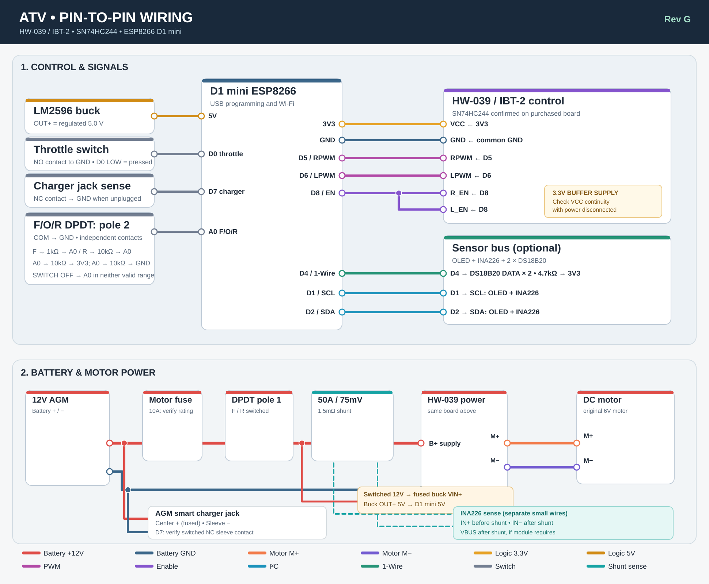

# ATV controller

[](https://github.com/iragm/atv/actions/workflows/firmware.yml) · [GPL-3.0](LICENSE)

ESP8266 D1 Mini + **HW-039 / IBT-2** motor controller for a 12V AGM-powered ride-on ATV. Includes a phone dashboard, configurable throttle, temperature monitoring, and current protection.

## Wiring



[Open the full-size wiring diagram](docs/diagrams/wiring-overview.svg)

| D1 Mini | Connect to |
|---|---|
| **3V3** | HW-039 **VCC**; INA226, OLED and DS18B20 VCC |
| **GND** | HW-039 GND; all sensor and switch grounds; buck OUT− |
| **5V** | 5.0V buck OUT+ |
| **D0** | Throttle switch → GND; 10kΩ pull-up to 3V3 |
| **D1 / D2** | I²C **SCL / SDA**, shared by INA226 and OLED |
| **D4** | Both DS18B20 data pins; 4.7kΩ pull-up to 3V3 |
| **D5 / D6** | HW-039 **RPWM / LPWM**; each 10kΩ pull-down to GND |
| **D7** | Unused (2-terminal charger jack; voltage monitoring instead) |
| **D8** | HW-039 **R_EN + L_EN** together; 10kΩ pull-down to GND |
| **A0** | F/O/R switch resistor ladder (below) |

**Direction switch:** Use two *isolated* poles of a DC-rated, center-off DPDT. Pole 1 switches fused battery +12V to the motor branch and buck in either F or R; center OFF disconnects both. Pole 2 has COM → GND, F → 1kΩ → A0, R → 10kΩ → A0. Also connect A0 → 10kΩ → 3V3 **and** A0 → 10kΩ → GND. Check the actual ADC readings and adjust `include/config.h` if needed.

**Power:** Battery + → motor fuse → DPDT pole 1 → **50A/75mV shunt** → HW-039 **B+**. Battery − → HW-039 **B−**. HW-039 **M+ / M−** → motor. The switched 12V also feeds a separately fused buck input; buck output **5.0V** powers D1 Mini. Connect the 2-terminal AGM charger jack directly to the battery (+ through its own fuse). Keep motor current out of sensor ground wires. Connect INA226 **IN+ / IN−** to the shunt's Kelvin sense taps, and VBUS after the shunt if required by the specific monitor board. Verify its calibration and onboard shunt arrangement.

**Your HW-039:** The board has an **SN74HC244** input buffer. Supply its **VCC from 3V3**, **not the buck's 5V**, *after confirming with a meter that this header pin powers the buffer on your board*. The BTS7960 control inputs accept 3.3V signals. No external 74AHCT125, 74AHCT02 or MCP23008 is used. Keep the board's built-in capacitor; **skip the extra bulk capacitor initially**. Check its printed voltage rating (prefer ≥25V on this 12V system) and add filtering only if bench testing shows a need. The motor itself may benefit from brush-noise suppression.

## Parts

| Part | Qty | Search |
|---|---:|---|
| ESP8266 D1 Mini | 1 | [Find](https://www.google.com/search?q=ESP8266+D1+Mini) |
| HW-039 / IBT-2 BTS7960 (SN74HC244) | 1 | [Find](https://www.google.com/search?q=HW-039+IBT-2+BTS7960+SN74HC244) |
| LM2596 12V→5V buck | 1 | [Find](https://www.google.com/search?q=LM2596+buck+module) |
| INA226 monitor + external 50A/75mV shunt | 1 each | [Find](https://www.google.com/search?q=INA226+external+50A+75mV+shunt) |
| DS18B20 waterproof probes | 2, optional | [Find](https://www.google.com/search?q=DS18B20+waterproof+temperature+probe) |
| SSD1306 I²C 128×64 OLED | 1, optional | [Find](https://www.google.com/search?q=SSD1306+0.96+I2C+OLED) |
| 12V AGM battery + compatible smart charger | 1 each | [Find](https://www.google.com/search?q=12V+AGM+battery+smart+charger) |
| DPDT center-off switch, throttle button, 2-terminal charger jack | 1 each | [Find](https://www.google.com/search?q=DC+rated+DPDT+center+off+switch+NC+switched+barrel+jack) |
| 10kΩ (8), 1kΩ (1), 4.7kΩ (1); fuses, wiring | as listed | [Find](https://www.google.com/search?q=resistor+kit+automotive+fuse+holder) |

Keep existing lights on a suitable separately fused switched supply. Confirm their 12V operating range before connecting them.

## Flash and connect

1. Set the buck to **5.0V with a meter** before connecting the D1 Mini. Check HW-039 VCC wiring, fuse, switch, and grounds with power off.
2. With the motor **disconnected**, flash the firmware:

   ```sh
   pio run -e d1_mini -t upload
   pio device monitor -b 115200
   ```

3. On your phone join `QUAD-XXXXXX`, password `quadsetup26`. The captive page should appear; otherwise open **http://192.168.4.1**. Change the Wi-Fi network name and password in the phone settings.
4. Connect the motor to a **current-limited bench supply**; verify direction, PWM, current readings and temperature probes before putting the ATV on the ground.

[Latest compiled firmware](https://github.com/iragm/atv/releases/download/firmware-latest/quad-controller-d1-mini.bin) (updated by passing CI).

## Phone settings

| Setting | Default |
|---|---:|
| Ramp time | **2 s** |
| Forward / reverse max | **6V / 4V equivalent** |
| Physical throttle release hold | **2 s** (fixed) |
| Motor / gearbox temp limit | **75°C / 70°C**; caps output at 5V equivalent |
| Instant sampled overcurrent cutoff | **Off** until calibrated |
| Sustained overload derating | **Off** until calibrated |
| Stall / possible no-load cutoff | **Off** until calibrated |
| Battery capacity | **7Ah placeholder**, editable |
| Charger voltage lockout | **13.0V**; restore under 12.8V for 5s |
| ATV Wi-Fi | `QUAD-<chip ID>` / `quadsetup26`, editable |
| OTA internet Wi-Fi | Empty by default; enter 2.4GHz network SSID/password |

The dark captive-portal dashboard shows PWM, motor current/power, battery voltage, temperatures, faults, a current graph, 5-minute average, automatic battery % from configured full/empty voltages and approximate runtime. It also has **hold-to-drive Wi-Fi forward/reverse**. Settings save to flash. Missing OLED, temperature sensors or INA226 won't prevent basic driving, but unavailable readings and their protections won't work.

**OTA:** Download the stable `.bin` above. To install from the ATV web page, set your 2.4GHz internet Wi-Fi credentials and press **Install latest**. The motor is disabled while updating. Alternatively, download `.bin` on your phone and upload it on the same page. Keep the direction switch powered and throttle released. Your phone may need mobile data to download the file before joining the ATV Wi-Fi.

**Charger detection:** The two-wire jack has no insertion signal. Firmware blocks motor output when **INA226 bus voltage > 13.0V** (settable). This is not reliable plug detection: a disconnected/idle charger or a missing INA226 can evade it. Keep the charger unplugged before driving.

**Battery gauge:** Set fully charged and empty voltages in the dashboard (defaults 12.8V and 11.8V), measured on a resting AGM battery. Percentage is linearly calculated from the smoothed INA226 voltage. Under load or while charging the estimate can be wrong. Runtime also requires battery capacity (Ah) and recent motor current; this does not measure accessory or charging current.

**Bench notes:** Check the D1 Mini ADC ladder values, HW-039 behavior with 3.3V inputs, INA226 shunt readings and 13V voltage inhibit. PWM “6V equivalent” still sends 12V pulses to the original 6V motor. Current cutoffs are *sampled software controls*, not instantaneous hardware protection. Use properly rated DC fuses, switches and wire; leave current thresholds off until measured. Charging current cannot be read with the existing motor-branch shunt. Wi-Fi uses local HTTP, so keep the AP password private.

## License

[GNU GPL v3](LICENSE).
